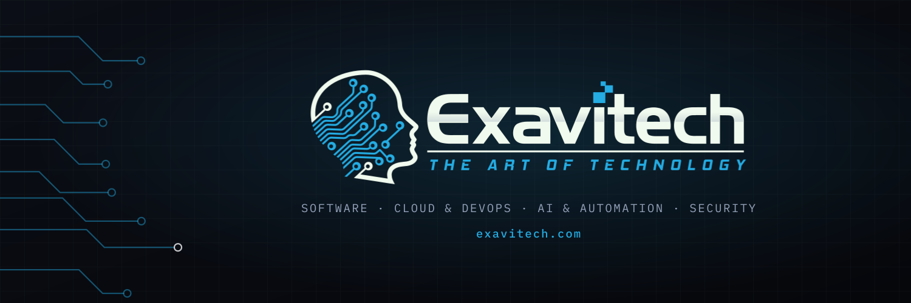

  

<b>We design, build and run the software your business depends on.</b> 
Engineers first. Consultants second.

  
  
  
  
  
  
  

### `// 01 — what we do`

- **Software development**: web, mobile and enterprise applications
- **Technology consulting**: solution architecture, digital transformation, technical due diligence
- **Cloud & DevOps**: infrastructure, CI/CD, managed hosting
- **AI & automation**: LLM integration, agents, workflow automation, data pipelines
- **Security & compliance**: hardening, audits, compliance readiness

### `// 02 — open source`

- [**claude-dev-hud**](https://github.com/exavitech/claude-dev-hud): a dev HUD for Claude Code (status line with 5h/weekly limits, server and git info, and a live tool-call and subagent side pane)

### `// 03 — work with us`

Need software built, or a second opinion on your architecture? → **[exavitech.com](https://www.exavitech.com/#contact)** · `social@exavitech.com`
